# 20 — The fixed direction: Find, rate, buy

**Status:** Find/Rate/Buy experience **CONFIRMED** (2026-11-10); typography, Deep Roast palette, textures, motifs and gradients **CONFIRMED** (2026-11-11). Sitemap/IA, final component contracts, motion and copy QA are **next**, not approved. Start with [23 — Next Design Phase](23-next-design-phase.md). No production code or route change is approved.

**Penpot:** file `New File 2` (`d2ec9836-375a-810a-8008-ebd27eb28057`). Workspace restructuring is **complete**; the original 46 G/H/I boards and all eight I-v2 homepage boards are preserved. The working redraws have their missing mixed-style content restored, though rich colours may not be pixel-identical. See [21](21-penpot-design-workspace.md).

The workspace is now organized into dedicated pages for direction, identity, homepage, directory, coffee detail, ratings, personalization, components, motion, copy and remaining templates. The former G/H/I exploration page is preserved as `90 · Archive`. **[21 — Penpot Design Workspace](21-penpot-design-workspace.md)** is the page-by-page map, preservation note and next-phase handoff.

| Page | What is active |
|---|---|
| `00 · Direction & principles` / `01 · Visual identity laboratory` | Creative baseline; page `01` has the `Identity DECIDED · 2026-11-11` board; the three earlier candidates were deleted |
| `02 · Homepage — I v2 (active experience)` | Original I-v2 desktop/mobile boards and two Penpot walkthrough flows, preserved |
| `03`–`06` | Editable **reference redraws** of directory/coffee/review/returning-user boards. Refer to page `90` originals for precise visual fidelity |
| `07`–`10` | Components, motion, copy, and other entity-template work areas |
| `90 · Archive — G/H/I explorations (originals)` | All 46 original boards retained |

## The direction

> A confident, distinctive evolution of ICB that preserves familiar browsing conventions while fundamentally improving visual storytelling, discovery continuity, review contribution and purchase journeys.

Familiar functionality, delivered through an exceptional experience.

1. **Two actions.** A visitor rates a coffee, or finds one and buys it from the roaster. The coffee page supports both; directory cards carry neither button.
2. **Conventional filters, packaging at the centre.** Roast, process, brew method and flavour work as people expect. Coffee imagery is the largest thing on screen.
3. **Every attribute is a doorway.** Estate, roaster, region, process and flavour each open the coffees that share them, in the same directory. No visible graph.
4. **A homepage that is alive and neutral.** One continuous editorial scroll: actions first, then new coffees, recent ratings, new roasters, field guide. No paid positions. Top Rated lives in the directory as a sort, with sample sizes.
5. **Ask, never assume.** A Buy click does not prove a purchase. Returning visitors are asked "Have you tried it?".
6. **Two funnels, measured separately.** Review: coffee view → rating initiated → submitted → repeat contributor. Purchase intent: coffee view → Buy click → roaster site.

The reasons and dates for each are in [07-decisions.md](07-decisions.md).

## Samples

These are frozen Penpot reference exports, **not a live data feed**. Real catalogue assets and dated database values were used in the storyboards, but some example labels, product placement, review text, simulated rating states and returning-user history are illustrative. Specifically, the I-v2 `Just Added` rail contains older filler cards and is **not a production-ready chronological feed**. Recheck counts, coffee/roaster identities, review data, recency and prices against the live site before implementation. See [21](21-penpot-design-workspace.md).

### Homepage (v2)

| Desktop | |
|---|---|
| 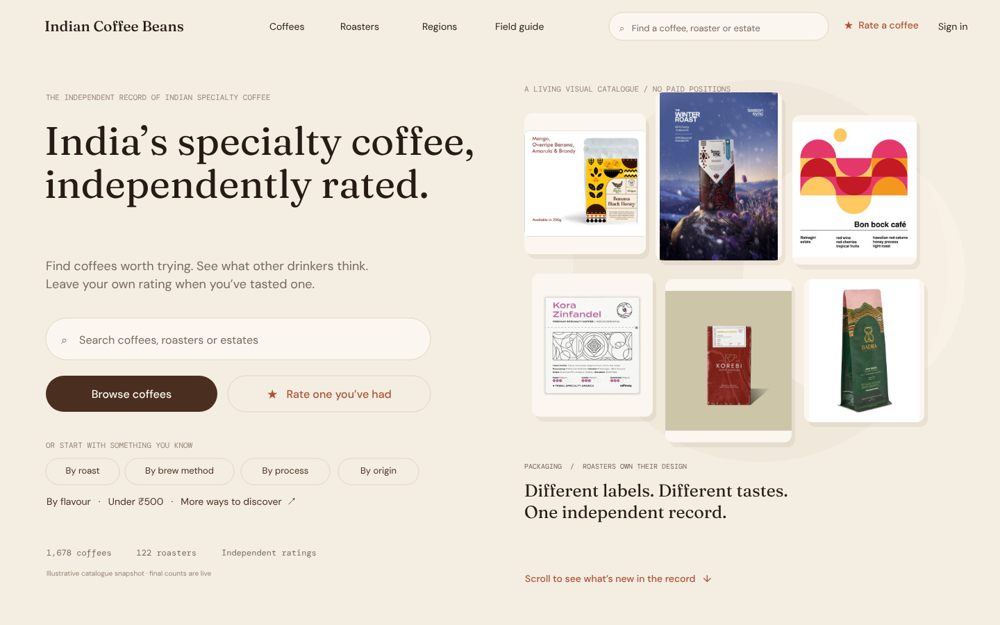 | **Arrival.** Search, Browse and Rate beside real packaging. |
| 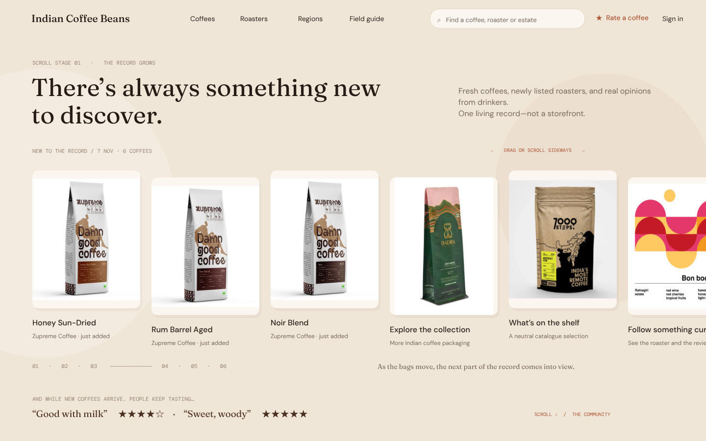 | **New coffees.** A sideways gallery of recent additions. |
| 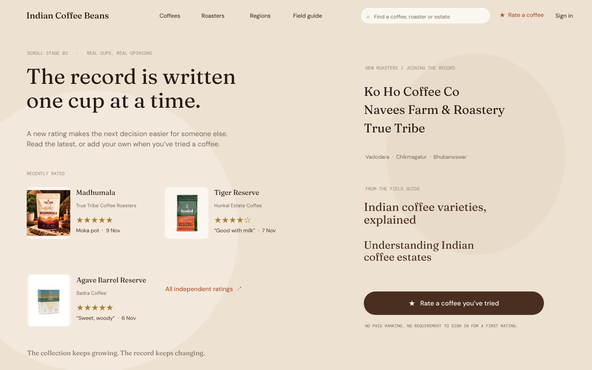 | **Community.** Recent ratings, new roasters, field guide, Rate. |

| Mobile 1 | Mobile 2 | Mobile 3 | Mobile 4 |
|---|---|---|---|
| 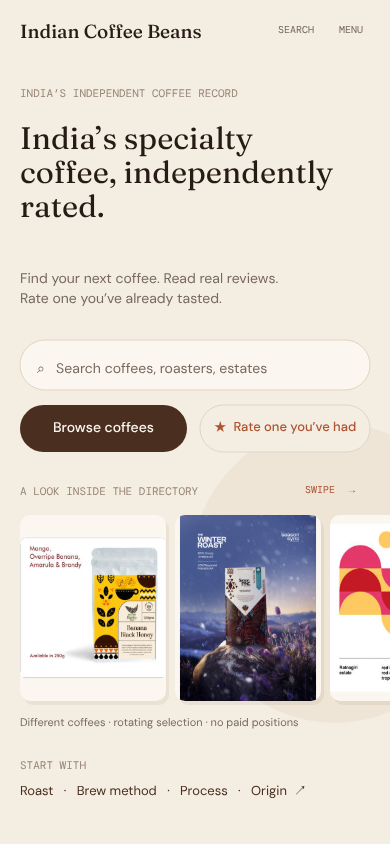 | 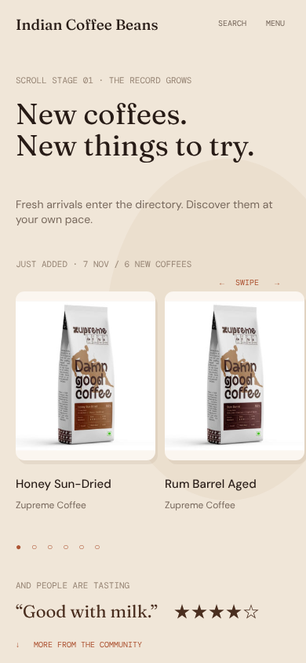 | 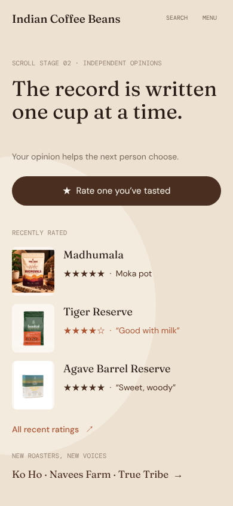 | 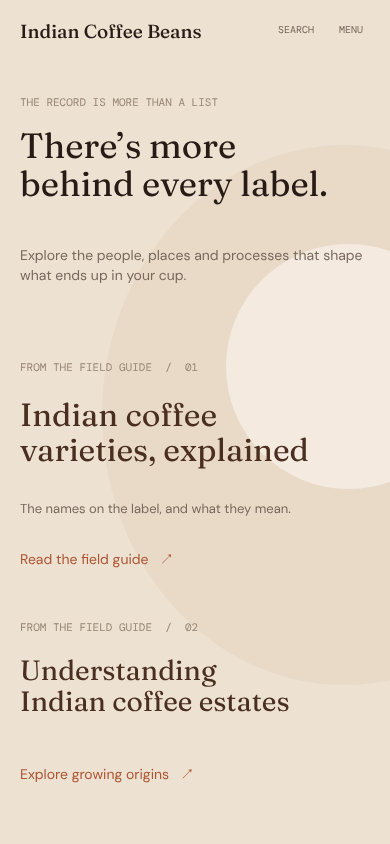 |

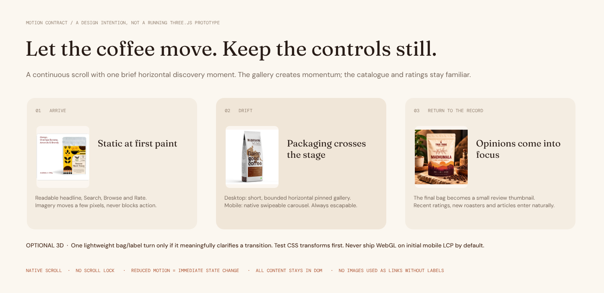

### Directory, coffee page, rating

| Mobile directory | Mobile coffee page | Mobile rating sheet |
|---|---|---|
| 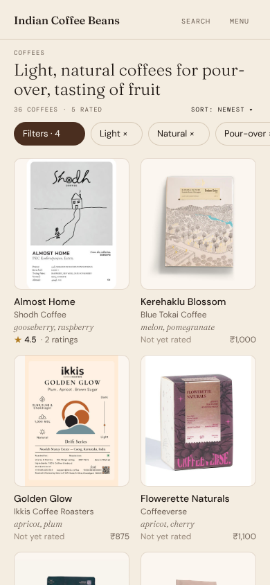 | 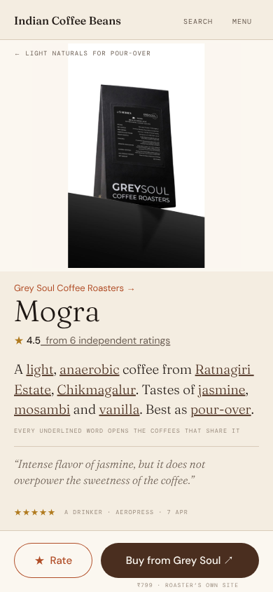 | 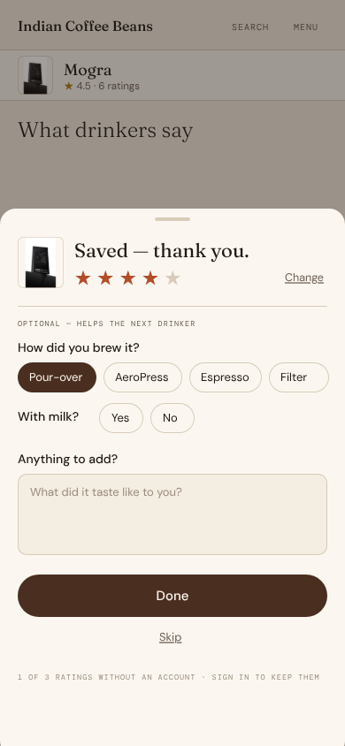 |

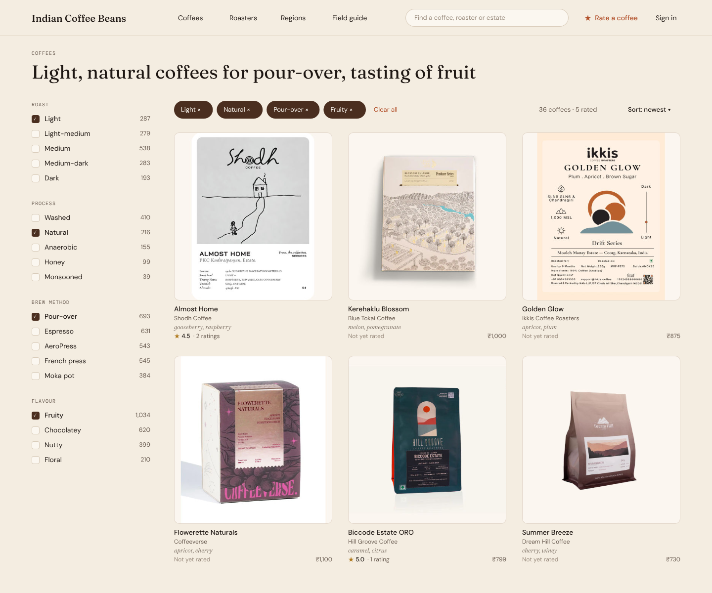
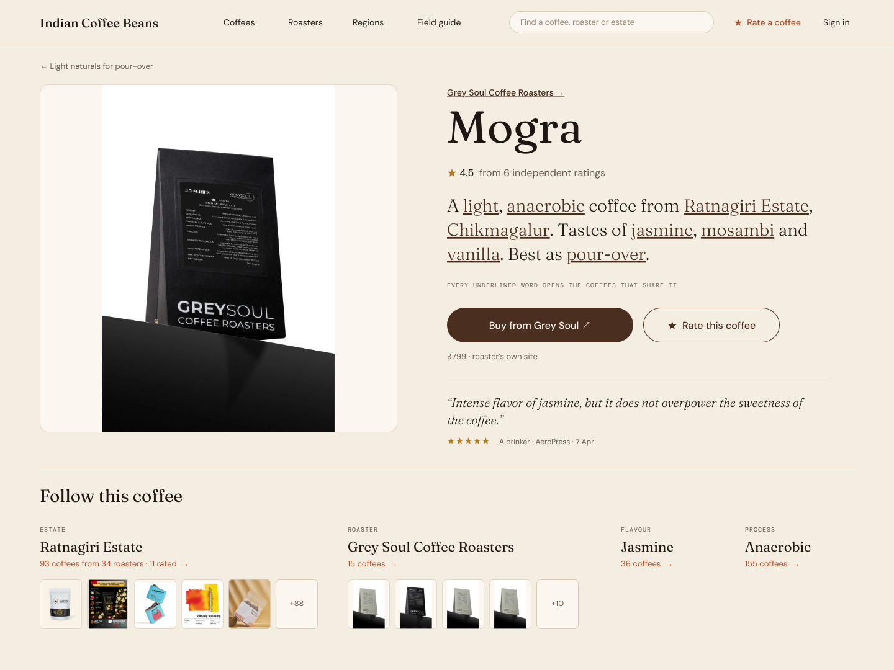
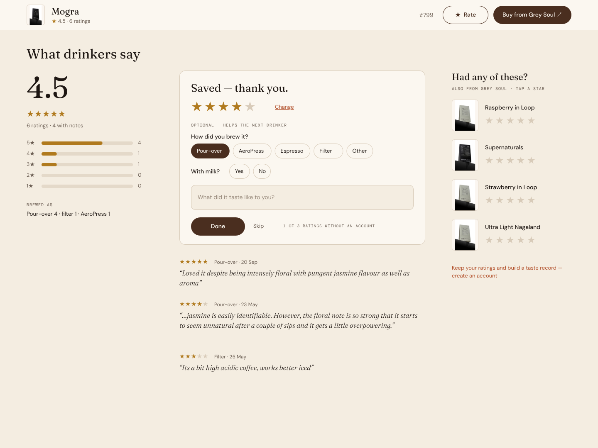

The earlier one-screen desktop homepage is kept for comparison: [samples/home-v1-desktop.png](samples/home-v1-desktop.png).

## Locked visual identity (reference; phase closed)

Next-stage sequence and gates are in **[23 — Information Architecture → Components → Copy](23-next-design-phase.md)**. Keep identity details below as the stable reference, not an invitation to run more visual alternatives.

**Brand character (CONFIRMED, 2026-11-11):** **"Quiet authority in the typography and information design; warmth in the colour and voice; curiosity and liveliness in the imagery, interactions and graphic details."** An optional supporting interpretation remains: *ICB provides the structure. Coffee provides the colour. People provide the personality.*

The three Penpot identity candidates (A · Editorial Heritage, B · Contemporary Craft, C · The Collector's Index) are **superseded** by the decisions below. Identity work now happens in the [playground](playground/index.html).

| Deep Roast, light | Deep Roast, dark | Mobile |
|---|---|---|
| 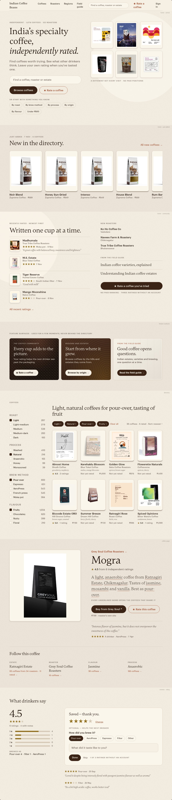 | 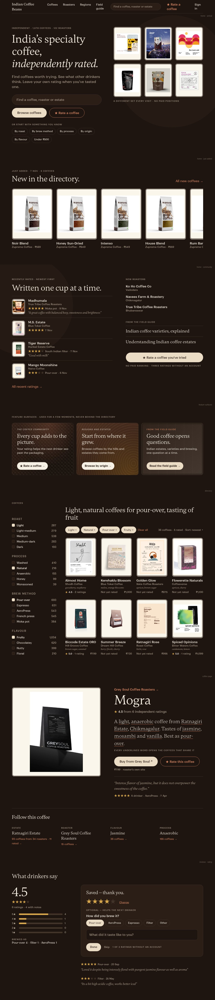 | 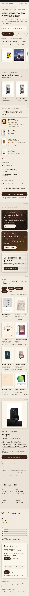 |

**Typefaces CONFIRMED (2026-11-11), from Fontshare:**

| Role | Typeface | Usage |
|---|---|---|
| Headings | Gambetta | H1–H4, coffee names, editorial titles |
| Body & UI | Ranade | Paragraphs, navigation, filters, buttons, ratings |
| Expressive display | Gambetta Italic | Selective editorial emphasis, quotations, special moments |

Weights, sizes and the small-label treatment are still open. Try them in the [playground](playground/index.html).

**Colour CONFIRMED (2026-11-11): Deep Roast, light and dark.** This replaces the A/B/C identity test and the "one palette" item below.

| Role | Light | Dark |
|---|---|---|
| Ground | `#FBF6EC` | `#1E1510` |
| Card | `#F6EFE3` | `#2A1E17` |
| Ink | `#1F130C` | `#F6EFE3` |
| Muted text | `#5F5145` | `#BFAF9D` |
| Hairline | `#D6C9B6` | `#43342A` |
| Primary (Buy, Browse) | `#3B2416` | `#EBDCC6` |
| Accent (Rate, links) | `#9C4526` | `#E28D66` |
| Star | `#93701F` | `#D9A84A` |

**Texture, motif and gradients are CONFIRMED and closed (2026-11-11):** restrained paper grain and package framing; an organic terrain contour signature; espresso wash for editorial photos; bottom scrim for text on images (side scrim when appropriate); selected Light + Contour ambient moments; and separate Roasted Weave / Estate Contour / Laid Paper feature treatments. See [22 — Visual System](22-visual-system.md). Their assignment to particular page intents remains OPEN.

**Historical only — superseded palette and fonts** (the original I boards remain an archive, not a design token source):

| | I boards | Homepage v2 |
|---|---|---|
| Type | Fraunces, DM Sans, DM Mono | same |
| Ink | `#1E1713` | `#271B16` |
| Muted text | `#6B5E53` | `#78695D`, labels `#978575` |
| Terracotta | `#B14E28` | `#AD5433` |
| Star gold | `#B07A1E` | `#AD7C33` |
| Brown (primary) | `#4A2E1F` | `#4A2E1F` |
| Ground | `#F4EDE1`, card `#FBF7F0` | `#F4EDE2` → `#F0E6D8` → `#EDE1D1` by stage |

**Still OPEN within implementation (not a reason to re-open the visual identity):** font sizes/weights and small-label treatment; dark-theme packaging plate and mixed-image framing specifics; sidebar, chart, focus and destructive UI tokens; icon library and internal/external arrow meaning; half-star rendering and accessibility; feature-surface assignment. Design these in Phase C of [23](23-next-design-phase.md).

### 1. Sitemap, navigation and page-template coverage — NEXT

Begin with a fresh **route/SEO audit**, then compare current versus proposed visitor-facing navigation, contextual discovery paths and entity templates. Preserve canonical URLs and existing redirect equity. Distinguish `/coffees/[slug]` **discovery landings** from the canonical coffee detail under `/roasters/[slug]/coffees/[coffeeSlug]`. Plan potential estates, varieties, gear and editorial connections only where data and existing ADRs support them. Owner approval is required before any route changes.

**Full Phase A brief and deliverables:** [23 — Next Design Phase](23-next-design-phase.md).

### 2. Information hierarchy, images, iconography and components

After sitemap/template sign-off, define content/provenance and exact dynamic states before designing buttons, cards, chips, filters, search, review evidence, doorway strips, navigation, image treatment and iconography. Set working CTA terminology here; polish it later. To settle here:
- One wording each for the Rate action, the search placeholder and the ratings link.
- **PROPOSED naming rule:** call visitor-facing browse/results the **directory**. Reserve `record` for editorial positioning, not another browsing destination. `Catalogue` is the underlying dataset, not a third user-facing nav choice.
- Desktop and mobile versions of the same component carrying the same information (ways in, recently rated).
- Tap-target sizes on mobile.
- Remove annotation text from designs ("Scroll stage 01", "Packaging / roasters own their design").

### 3. Motion

Starts from the motion grammar board: static at first paint, one native sideways-scrolling gallery, reduced motion as an immediate state change, all content in the DOM, no WebGL on initial mobile load by default. **PROPOSED for the next prototype (not owner-confirmed):** a normal horizontal rail on desktop and mobile; no vertical scroll hijack or pinned scroll-to-sideways mapping. Scroll-linked transforms/Three.js remain optional experimental enhancement behind performance/accessibility gates, not the base interaction.

### 4. Final copy and cross-template QA (wording begins in the IA phase)

Establish navigation language, user tasks and provenance vocabulary **during IA and content architecture**; **finalize** CTAs, error/empty states, microcopy and consistency after component and interaction testing. Fix annotation text, contrast, screen-reader labels and mobile touch targets before any implementation handoff; don't assume these resolve solely by choosing a font.

## Open rules to decide before they are built

These are behaviour and content rules, not styling, so the phases above will not settle them on their own.

1. **Gallery behaviour — PROPOSED:** native horizontally scrollable row on desktop and mobile. No pinning that converts vertical scroll into horizontal movement. Optional passive scroll-linked motion may be prototyped separately and must remain skippable/reduced-motion safe.
2. **Separate editorial selection from chronology — PROPOSED, needs owner test:** a neutral *Browse the directory* visual rail may rotate authentic coffees using a documented independent selection rule (e.g. diversify the first visible set across roasters), and must never claim those coffees were just added. A separate *Just added* feed is genuinely chronological, with actual dates/coffee counts and no older filler, even if several coffees came from one roaster. If too many consecutive new arrivals share a roaster, group honestly by roaster or widen a clearly disclosed recent window; do not silently fabricate recency. No sponsored placement or paid rank. Final policy and balance of diversity vs chronology are still OPEN.
3. **Copy accuracy — OPEN final system QA:** the catalogue totals are a dated verified snapshot, not automatically live numbers; anonymous rating supports **three distinct entities** before login; roasters are listed independently, not necessarily 'joining'; distinguish roaster claims, ICB inferences and drinkers' words. Treat gallery cards, ratings, reviews and prices in Penpot as dated examples, not a live production feed.
4. **Desktop/mobile parity — OPEN:** align navigation labels, search text, the quick Rate CTA, ratings links, facet entry points and source/recency data. **PROPOSED:** reserve ↗ for leaving ICB and → for internal navigation.
5. **Rate versus Buy colour roles — PROPOSED:** on coffee detail, Buy uses a filled dark/brown action and Rate uses a contrasting accent outline; in the dedicated rating flow, the submit action can be filled. This is under identity test, not a brand approval.

## Deferred without being abandoned

The chosen I direction does **not** cancel the owner-approved vision for logged-in personalization, a contextual website AI Concierge (`3lokai/icb-chatbot`), or ethical monetization of aggregated coffee intelligence. These are later delivery phases, but need design homes and clear data/trust guardrails **now**:

- **Returning experience:** existing homepage hero segments/recent views and saved ratings/gear; don't equate view or outbound Buy clicks with an actual tasting. A personalized I homepage remains to be drawn and validated.
- **AI Concierge:** optional first-party guidance for choosing, brewing, interpreting reviews, and proposing explicit, validated filters/links. Never author fake independent reviews or alter organic ranking. No mandatory chatbot bubble; website integration isn't implemented.
- **Business flywheel:** credible distinct reviewers and coffee review coverage, quality/context, return-to-rate, purchase-intent click measurement (not assumed sales), representative aggregate insights, licensed data/API and industry research. [17](17-review-intelligence-and-monetization.md) remains binding.
- **Entity coverage:** roaster, region, estate, articles, tools, account and other site templates still need to share the identity and rating/discovery principles. Do not claim the homepage is the whole site.
- **Copy/content:** provenance labels, FAQ, negative/empty states and neutral editorial policy belong to the system, not a late cosmetic pass.

## Not drawn yet

- Desktop: directory reached through a doorway, returning-visitor homepage.
- Homepage v2 for a returning visitor.
- Roaster, region and estate pages, search results, account.
